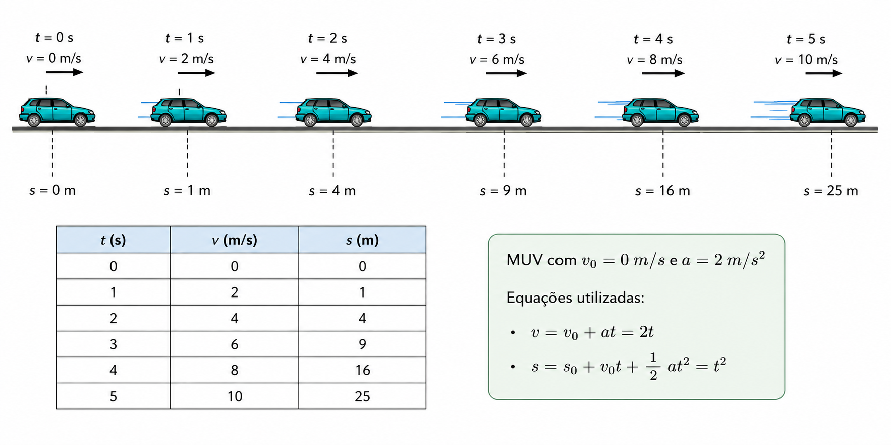

## Movimento Uniformemente Variado 

```{python}
#| echo: false
import sys
sys.path.append("../../../src")   # onde está o dp_style.py

import plotly.graph_objects as go
from plotly.offline import get_plotlyjs
from IPython.display import HTML, display
import dp_style

# Cores (azul e vermelho vêm do tema; as demais seguem a paleta do styles.css)
AZUL, VERMELHO = dp_style.PALETTE["azul"], dp_style.PALETTE["vermelho"]
LARANJA, VERDE, ROXO, MARROM = "#ff8a42", "#34d399", "#c084fc", "#d9a066"
LARANJA_F = "rgba(255,138,66,0.25)"
VERDE_F = "rgba(52,211,153,0.25)"

# A biblioteca plotly.js vai embutida (funciona offline), UMA vez só e em uma
# saída SEPARADA dos gráficos (se saírem juntos, o Quarto tira o gráfico do slide).
display(HTML("<script>" + get_plotlyjs() + "</script>"))

# O Reveal só dimensiona os gráficos quando o slide aparece
display(HTML("""
<script>
(function () {
  function r() {
    if (!window.Plotly) return;
    document.querySelectorAll('.plotly-graph-div').forEach(function (g) { Plotly.Plots.resize(g); });
  }
  var t = setInterval(function () {
    if (window.Reveal && Reveal.on) {
      clearInterval(t);
      Reveal.on('ready', r); Reveal.on('slidechanged', r); Reveal.on('resize', r);
      r();
    }
  }, 200);
  window.addEventListener('resize', r);
})();
</script>
<style>
  .dp-controles { font-size: 0.8em; }
  .dp-controles label { display: block; margin: 0.6em 0; }
  .dp-controles input[type=range] { width: 100%; accent-color: rgb(var(--azul)); }
  .dp-controles .dp-lido { margin-top: 0.8em; line-height: 1.6; color: rgb(var(--chalk-dim)); }
  .dp-controles .dp-lido b { color: rgb(var(--azul)); }
</style>
"""))


def mostrar(fig, div_id, altura=360, legenda=False, margem_dir=15):
    """Aplica o estilo do tema e escreve o gráfico no slide."""
    fig = dp_style.plotly(fig, legend=False)
    fig.update_layout(height=altura, margin=dict(l=55, r=margem_dir, t=10, b=45))
    if legenda:
        fig.update_layout(showlegend=True,
                          legend=dict(x=0.02, y=0.98, bgcolor="rgba(0,0,0,0)"))
    display(HTML(fig.to_html(
        include_plotlyjs=False, full_html=False, div_id=div_id,
        default_height=f"{altura}px", default_width="100%",
        config={"responsive": True, "displayModeBar": False},
    )))


def slider(id_, rotulo, mn, mx, passo, valor, unidade=""):
    """Controle deslizante; o valor mostrado é atualizado pelo JavaScript."""
    return (f'<label>{rotulo}: <b id="{id_}-val">{valor}</b> {unidade}'
            f'<input id="{id_}" type="range" min="{mn}" max="{mx}" '
            f'step="{passo}" value="{valor}"></label>')
```

::::: columns
:::: {.column width="50%"}
**Velocidade constante:** rapidez constante significa rapidez uniforme. Algo que se mova com uma rapidez constante não aumenta nem diminui sua rapidez. Velocidade constante, por outro lado, significa que a rapidez e a orientação são constantes. Orientação constante significa em linha reta: a trajetória do objeto não possui curvas. Assim, velocidade constante significa movimento retilíneo com rapidez constante.

**Velocidade variável:** se a rapidez ou a orientação variar (ou ambas variarem), a velocidade variará. Um vagão que se desloca sobre um trilho em curva, por exemplo, pode ter rapidez constante; todavia, uma vez que sua orientação de movimento está variando, sua velocidade não será constante. Na próxima seção, veremos que, neste caso, ele está acelerando.
::::

:::: {.column width="50%"}
**Aceleração:** indica a rapidez com que ocorre determinada variação na velocidade instantânea desse móvel. É muito comum dizer que um corpo que se movimenta com velocidade variável tem aceleração.

Um carro cuja velocidade aumenta de 0 a 80 km/h, em determinado intervalo de tempo, está acelerando. Se outro carro puder ter essa mesma variação de velocidade, mas em um intervalo de tempo menor, então poderemos dizer que esse segundo carro tem uma aceleração maior. Concluímos, portanto, que, para uma mesma variação de velocidade $\Delta v$, a aceleração é inversamente proporcional ao intervalo de tempo $\Delta t$ no qual se deu tal variação de velocidade.
::::
:::::

------------------------------------------------------------------------

## Tabela de um MUV

::::: columns
:::: {.column width="45%"}
Considere um móvel que parte do repouso:

$$v_0 = 0\,\text{m/s} \qquad a = 2\,\text{m/s}^2$$

As equações do movimento são:

$$v = 2t \qquad s = t^2$$
::::

:::: {.column width="55%"}
| Tempo ($t$) (s) | Velocidade ($v$) (m/s) | Posição ($s$) (m) |
|:---------------:|:----------------------:|:-----------------:|
|        0        |           0            |         0         |
|        1        |           2            |         1         |
|        2        |           4            |         4         |
|        3        |           6            |         9         |
|        4        |           8            |        16         |
|        5        |           10           |        25         |
::::
:::::

------------------------------------------------------------------------

## Tabela de um MUV: posição do carro a cada segundo



------------------------------------------------------------------------

## O que é o MUV?

**Movimento Uniformemente Variado (MUV)** é aquele em que a velocidade **muda de forma constante** ao longo do tempo.

::::: columns
:::: {.column width="50%"}
**A grande característica:** a **aceleração é constante** e **diferente de zero**.

$$a = \text{constante} \neq 0$$
::::

:::: {.column width="50%"}
::: callout-note
### Diferença fundamental

- **MU:** velocidade constante → $a = 0$
- **MUV:** velocidade varia → $a = \text{cte} \neq 0$
:::
::::
:::::

------------------------------------------------------------------------

## Aceleração

::::: columns
:::: {.column width="55%"}
A **aceleração** mede a **taxa de variação da velocidade** por unidade de tempo.

$$\boxed{a = \frac{\Delta v}{\Delta t} = \frac{v - v_0}{t}}$$

::: callout-tip
### Dica de sinal

- $a > 0$ → objeto **acelera** (velocidade aumenta)
- $a < 0$ → objeto **desacelera** (velocidade diminui)
:::
::::

:::: {.column width="45%"}
| Grandeza           | Símbolo | Unidade SI |
|:-------------------|:-------:|:----------:|
| Aceleração         |   $a$   |    m/s²    |
| Velocidade final   |   $v$   |    m/s     |
| Velocidade inicial |  $v_0$  |    m/s     |
| Tempo              |   $t$   |     s      |
::::
:::::

------------------------------------------------------------------------

## As 3 Equações do MUV

::::: columns
::: {.column width="33%"}
### Eq. Horária da Velocidade

$$\boxed{v = v_0 + at}$$

Relaciona: $v$, $v_0$, $a$, $t$
:::

::: {.column width="33%"}
### Eq. Horária do Espaço

$$\boxed{s = s_0 + v_0 t + \frac{at^2}{2}}$$

Relaciona: $s$, $s_0$, $v_0$, $a$, $t$
:::

::: {.column width="34%"}
### Equação de Torricelli

$$\boxed{v^2 = v_0^2 + 2a\Delta s}$$

Relaciona: $v$, $v_0$, $a$, $\Delta s$
:::
:::::

::: callout-important
**Torricelli** é especial: **não depende do tempo!** Use quando $t$ não é dado nem pedido.
:::

------------------------------------------------------------------------

## Dedução: Equação de Torricelli

::::: columns
:::: {.column width="50%"}
::: passo
Isolando $t$ na primeira equação:

$$t = \frac{v - v_0}{a}$$
:::

::: passo
Substituindo na equação do espaço:

$$\Delta s = v_0\left(\frac{v - v_0}{a}\right) + \frac{a}{2}\left(\frac{v - v_0}{a}\right)^2$$
:::
::::

:::: {.column width="50%"}
::: passo
Multiplicando toda a equação por $2a$ e simplificando:

$$2a\Delta s = 2v_0(v - v_0) + (v - v_0)^2$$

$$2a\Delta s = v^2 - v_0^2$$
:::

::: resposta
Logo,

$$\boxed{v^2 = v_0^2 + 2a\Delta s}$$
:::
::::
:::::

------------------------------------------------------------------------

## Gráfico v × t

::::: columns
:::: {.column width="35%"}
```{python}
#| echo: false
HTML('<div class="dp-controles">'
     + slider("vt-v0", "Velocidade inicial (v₀)", -5, 5, 1, 5, "m/s")
     + slider("vt-a", "Aceleração (a)", -3, 3, 0.5, 2.0, "m/s²")
     + '<div class="dp-lido" id="vt-lido"></div></div>'
     + """
<script>
(function () {
  var iv = document.getElementById('vt-v0'), ia = document.getElementById('vt-a');
  var ts = []; for (var i = 0; i <= 80; i++) ts.push(i * 0.1);
  function upd() {
    var v0 = parseFloat(iv.value), a = parseFloat(ia.value), vf = v0 + a * 8;
    var g = document.getElementById('graf-vt');
    if (g && window.Plotly && g.data) {
      Plotly.restyle(g, {y: [ts.map(function (t) { return v0 + a * t; })]}, [0]);
      Plotly.restyle(g, {y: [[v0, vf]]}, [1]);
    }
    document.getElementById('vt-v0-val').textContent = v0.toFixed(0);
    document.getElementById('vt-a-val').textContent = a.toFixed(1);
    document.getElementById('vt-lido').innerHTML =
      'v(8 s) = <b>' + vf.toFixed(1) + ' m/s</b><br>' +
      'Área = Δs = <b>' + ((v0 + vf) / 2 * 8).toFixed(1) + ' m</b><br>' +
      'Inclinação = a = <b>' + a.toFixed(1) + ' m/s²</b>';
  }
  iv.addEventListener('input', upd); ia.addEventListener('input', upd); upd();
})();
</script>
""")
```
::::

:::: {.column width="65%"}
```{python}
#| echo: false
ts = [i * 0.1 for i in range(81)]
v0, a = 5, 2.0

fig = go.Figure()
# traço 0: a reta v(t), com a área (deslocamento) sombreada
fig.add_trace(go.Scatter(
    x=ts, y=[v0 + a * t for t in ts], mode="lines", fill="tozeroy", fillcolor=VERDE_F,
    line=dict(color=LARANJA, width=4),
    hovertemplate="t = %{x:.1f} s<br>v = %{y:.1f} m/s<extra></extra>",
))
# traço 1: v₀ (t = 0) e v final (t = 8 s)
fig.add_trace(go.Scatter(
    x=[0, 8], y=[v0, v0 + a * 8], mode="markers",
    marker=dict(color=VERMELHO, size=11), hoverinfo="skip",
))
fig.update_xaxes(range=[0, 8], title="t (s)", zeroline=True, zerolinewidth=2)
fig.update_yaxes(range=[-30, 30], title="v (m/s)", zeroline=True, zerolinewidth=2)
mostrar(fig, "graf-vt", altura=380)
```
::::
:::::

------------------------------------------------------------------------

## Gráfico s × t

::::: columns
:::: {.column width="35%"}
```{python}
#| echo: false
HTML('<div class="dp-controles">'
     + slider("st-v0", "Velocidade inicial (v₀)", -5, 5, 1, 5, "m/s")
     + slider("st-a", "Aceleração (a)", -5, 5, 0.5, 2.0, "m/s²")
     + slider("st-s0", "Posição inicial (s₀)", -10, 10, 1, 0, "m")
     + '<div class="dp-lido" id="st-lido"></div></div>'
     + """
<script>
(function () {
  var iv = document.getElementById('st-v0'), ia = document.getElementById('st-a'),
      is = document.getElementById('st-s0');
  var ts = []; for (var i = 0; i <= 80; i++) ts.push(i * 0.1);
  function upd() {
    var v0 = parseFloat(iv.value), a = parseFloat(ia.value), s0 = parseFloat(is.value);
    var ss = ts.map(function (t) { return s0 + v0 * t + 0.5 * a * t * t; });
    var lo = Math.min(0, Math.min.apply(null, ss)), hi = Math.max(0, Math.max.apply(null, ss));
    var pad = Math.max(3, (hi - lo) * 0.12);
    var sMid = s0 + v0 * 4 + 0.5 * a * 16, vMid = v0 + a * 4;
    var g = document.getElementById('graf-st');
    if (g && window.Plotly && g.data) {
      Plotly.restyle(g, {y: [ss]}, [0]);
      Plotly.restyle(g, {y: [[sMid - vMid * 1.5, sMid + vMid * 1.5]]}, [1]);
      Plotly.restyle(g, {y: [[s0, sMid]]}, [2]);
      Plotly.relayout(g, {'yaxis.range': [lo - pad, hi + pad]});
    }
    document.getElementById('st-v0-val').textContent = v0.toFixed(0);
    document.getElementById('st-a-val').textContent = a.toFixed(1);
    document.getElementById('st-s0-val').textContent = s0.toFixed(0);
    var conc = a > 0 ? 'voltada para cima (a &gt; 0)' : a < 0 ? 'voltada para baixo (a &lt; 0)' : 'reta (a = 0)';
    document.getElementById('st-lido').innerHTML =
      'Concavidade: <b>' + conc + '</b><br>' +
      'Tangente em t = 4 s: v = <b>' + vMid.toFixed(1) + ' m/s</b>';
  }
  iv.addEventListener('input', upd); ia.addEventListener('input', upd);
  is.addEventListener('input', upd); upd();
})();
</script>
""")
```
::::

:::: {.column width="65%"}
```{python}
#| echo: false
ts = [i * 0.1 for i in range(81)]
v0, a, s0 = 5, 2.0, 0
ss = [s0 + v0 * t + 0.5 * a * t * t for t in ts]
lo, hi = min(0, min(ss)), max(0, max(ss))
pad = max(3, (hi - lo) * 0.12)
sMid, vMid = s0 + v0 * 4 + 0.5 * a * 16, v0 + a * 4

fig = go.Figure()
# traço 0: a parábola s(t)
fig.add_trace(go.Scatter(
    x=ts, y=ss, mode="lines", line=dict(color=AZUL, width=4),
    hovertemplate="t = %{x:.1f} s<br>s = %{y:.1f} m<extra></extra>",
))
# traço 1: tangente em t = 4 s (a inclinação é a velocidade)
fig.add_trace(go.Scatter(
    x=[2.5, 5.5], y=[sMid - vMid * 1.5, sMid + vMid * 1.5], mode="lines",
    line=dict(color=VERMELHO, width=2, dash="dash"), hoverinfo="skip",
))
# traço 2: posição inicial (t = 0) e ponto de tangência (t = 4 s)
fig.add_trace(go.Scatter(
    x=[0, 4], y=[s0, sMid], mode="markers",
    marker=dict(color=[AZUL, VERMELHO], size=11), hoverinfo="skip",
))
fig.update_xaxes(range=[0, 8], title="t (s)", zeroline=True, zerolinewidth=2)
fig.update_yaxes(range=[lo - pad, hi + pad], title="s (m)", zeroline=True, zerolinewidth=2)
mostrar(fig, "graf-st", altura=380)
```
::::
:::::

------------------------------------------------------------------------

## Gráfico a × t

::::: columns
:::: {.column width="35%"}
```{python}
#| echo: false
HTML('<div class="dp-controles">'
     + slider("at-a", "Aceleração (a)", -6, 6, 0.5, 3.0, "m/s²")
     + slider("at-v0", "Velocidade em t = 1 s", -20, 20, 1, 5, "m/s")
     + '<div class="dp-lido" id="at-lido"></div></div>'
     + """
<script>
(function () {
  var ia = document.getElementById('at-a'), iv = document.getElementById('at-v0');
  function upd() {
    var a = parseFloat(ia.value), v0 = parseFloat(iv.value), dv = a * 5, vf = v0 + dv;
    var g = document.getElementById('graf-at');
    if (g && window.Plotly && g.data) {
      Plotly.restyle(g, {y: [[a, a]]}, [0]);
      Plotly.restyle(g, {y: [[a, a]], fillcolor: [a >= 0 ? 'rgba(52,211,153,0.35)' : 'rgba(255,92,92,0.35)']}, [1]);
      Plotly.restyle(g, {y: [[0, a, null, 0, a]]}, [2]);
    }
    document.getElementById('at-a-val').textContent = a.toFixed(1);
    document.getElementById('at-v0-val').textContent = v0.toFixed(0);
    document.getElementById('at-lido').innerHTML =
      'Área entre 1 s e 6 s: Δv = a · Δt = <b>' + dv.toFixed(1) + ' m/s</b><br>' +
      'v(6 s) = ' + v0.toFixed(0) + ' + ' + dv.toFixed(1) + ' = <b>' + vf.toFixed(1) + ' m/s</b>';
  }
  ia.addEventListener('input', upd); iv.addEventListener('input', upd); upd();
})();
</script>
""")
```
::::

:::: {.column width="65%"}
```{python}
#| echo: false
a = 3.0

fig = go.Figure()
# traço 0: a aceleração constante
fig.add_trace(go.Scatter(
    x=[0, 8], y=[a, a], mode="lines", line=dict(color=ROXO, width=4),
    hovertemplate="a = %{y:.1f} m/s²<extra></extra>",
))
# traço 1: área entre t = 1 s e t = 6 s (variação de velocidade)
fig.add_trace(go.Scatter(
    x=[1, 6], y=[a, a], mode="lines", fill="tozeroy", fillcolor="rgba(52,211,153,0.35)",
    line=dict(width=0), hoverinfo="skip",
))
# traço 2: linhas que delimitam a área
fig.add_trace(go.Scatter(
    x=[1, 1, None, 6, 6], y=[0, a, None, 0, a], mode="lines",
    line=dict(color=VERDE, width=2, dash="dash"), hoverinfo="skip",
))
fig.update_xaxes(range=[0, 8], title="t (s)", zeroline=True, zerolinewidth=2)
fig.update_yaxes(range=[-8, 8], title="a (m/s²)", zeroline=True, zerolinewidth=2)
mostrar(fig, "graf-at", altura=380)
```
::::
:::::

# Problemas Resolvidos

## Problema 1

::::: columns
:::: {.column width="50%"}
::: enunciado
Um carro parte do repouso e acelera uniformemente com $a = 3\ \text{m/s}^2$. Qual a velocidade após 8 segundos?
:::

**Dados:** $v_0 = 0$, $a = 3\ \text{m/s}^2$, $t = 8\ \text{s}$, $v = ?$
::::

:::: {.column width="50%"}
$$v = v_0 + at = 0 + 3 \times 8 \Rightarrow \boxed{v = 24\ \text{m/s}}$$

**Convertendo:** $24\ \text{m/s} \times 3{,}6 = 86{,}4\ \text{km/h}$
::::
:::::

------------------------------------------------------------------------

## Problema 1: Visualização

```{python}
#| echo: false
ts = [i * 0.1 for i in range(101)]

fig = go.Figure()
fig.add_trace(go.Scatter(
    x=ts, y=[3 * t for t in ts], mode="lines", fill="tozeroy", fillcolor=LARANJA_F,
    line=dict(color=LARANJA, width=4),
    hovertemplate="t = %{x:.1f} s<br>v = %{y:.1f} m/s<extra></extra>",
))
# guias até o ponto (t = 8 s, v = 24 m/s)
fig.add_trace(go.Scatter(
    x=[0, 8, 8], y=[24, 24, 0], mode="lines",
    line=dict(color=VERMELHO, width=2, dash="dash"), hoverinfo="skip",
))
fig.add_trace(go.Scatter(
    x=[8], y=[24], mode="markers+text", text=["v = 24 m/s"], textposition="top left",
    textfont=dict(color=VERMELHO, size=16), marker=dict(color=VERMELHO, size=12),
    hoverinfo="skip",
))
fig.update_xaxes(range=[0, 10], title="t (s)")
fig.update_yaxes(range=[0, 32], title="v (m/s)")
mostrar(fig, "graf-p1", altura=400)
```

$v(t) = 0 + 3t \quad\Rightarrow\quad v(8) = 24\ \text{m/s}$

------------------------------------------------------------------------

## Problema 2

::: enunciado
Um móvel parte de $s_0 = 10\ \text{m}$, com $v_0 = 5\ \text{m/s}$ e $a = 2\ \text{m/s}^2$. Qual a posição após $t = 4\ \text{s}$?
:::

$$s = s_0 + v_0 t + \frac{at^2}{2} = 10 + 5(4) + \frac{2(16)}{2} = 10 + 20 + 16$$

$$\boxed{s = 46\ \text{m}}$$

------------------------------------------------------------------------

## Problema 2: Visualização

```{python}
#| echo: false
ts = [i * 0.1 for i in range(61)]

fig = go.Figure()
fig.add_trace(go.Scatter(
    x=ts, y=[10 + 5 * t + t * t for t in ts], mode="lines",
    line=dict(color=AZUL, width=4),
    hovertemplate="t = %{x:.1f} s<br>s = %{y:.1f} m<extra></extra>",
))
fig.add_trace(go.Scatter(
    x=[4, 4, 0], y=[0, 46, 46], mode="lines",
    line=dict(color=VERMELHO, width=2, dash="dash"), hoverinfo="skip",
))
fig.add_trace(go.Scatter(
    x=[4], y=[46], mode="markers+text", text=["s = 46 m"], textposition="top left",
    textfont=dict(color=VERMELHO, size=16), marker=dict(color=VERMELHO, size=12),
    hoverinfo="skip",
))
fig.update_xaxes(range=[0, 6], title="t (s)")
fig.update_yaxes(range=[0, 80], title="s (m)")
mostrar(fig, "graf-p2", altura=400)
```

$s(t) = 10 + 5t + t^2 \quad\Rightarrow\quad s(4) = 46\ \text{m}$

------------------------------------------------------------------------

## Problema 3

::::: columns
:::: {.column width="40%"}
::: enunciado
Um trem a $20\ \text{m/s}$ freia com $a = -4\ \text{m/s}^2$. Qual a distância percorrida até parar?
:::

$$v^2 = v_0^2 + 2a\Delta s$$

$$0 = 400 - 8\Delta s$$

$$\boxed{\Delta s = 50\ \text{m}}$$
::::

:::: {.column width="60%"}
```{python}
#| echo: false
ts = [i * 0.1 for i in range(51)]   # 0 a 5 s (o trem para em t = 5 s)

fig = go.Figure()
fig.add_trace(go.Scatter(
    x=ts, y=[20 - 4 * t for t in ts], mode="lines", fill="tozeroy", fillcolor=LARANJA_F,
    line=dict(color=LARANJA, width=4),
    hovertemplate="t = %{x:.1f} s<br>v = %{y:.1f} m/s<extra></extra>",
))
fig.add_trace(go.Scatter(
    x=[0], y=[20], mode="markers+text", text=["v₀ = 20 m/s"], textposition="top right",
    textfont=dict(color=AZUL, size=15), marker=dict(color=AZUL, size=11), hoverinfo="skip",
))
fig.add_trace(go.Scatter(
    x=[5], y=[0], mode="markers+text", text=["v = 0 (para)"], textposition="top right",
    textfont=dict(color=VERMELHO, size=15), marker=dict(color=VERMELHO, size=11),
    hoverinfo="skip",
))
fig.add_annotation(x=2, y=7, text="Área = Δs = 50 m", showarrow=False,
                   font=dict(color=VERDE, size=16))
fig.update_xaxes(range=[0, 7], title="t (s)")
fig.update_yaxes(range=[-2, 25], title="v (m/s)")
mostrar(fig, "graf-p3", altura=340)
```
::::
:::::

------------------------------------------------------------------------

## Problema 4

::: enunciado
Um motociclista vai de $36\ \text{km/h}$ a $72\ \text{km/h}$ em $5\ \text{s}$. Qual sua aceleração, em $\text{m/s}^2$?
:::

$$v_0 = 10\ \text{m/s}, \quad v = 20\ \text{m/s} \Rightarrow a = \frac{20 - 10}{5} = \boxed{2\ \text{m/s}^2}$$

------------------------------------------------------------------------

## Problema 5

::: enunciado
Dois carros partem do repouso e da mesma posição em uma pista reta. O carro A inicia o movimento em $t = 0$ com aceleração constante de $4\ \text{m/s}^2$. O carro B inicia o movimento 3 s depois, com aceleração constante de $9\ \text{m/s}^2$. Em que instante o carro B alcança o carro A? Qual é a posição do encontro?
:::

::::: columns
:::: {.column width="50%"}
$$s_A = 2t^2 \qquad s_B = \frac{9(t-3)^2}{2}$$

$$2t^2 = \frac{9(t-3)^2}{2} \Rightarrow 5t^2 - 54t + 81 = 0$$

$$\boxed{t = 9\ \text{s}}$$
::::

:::: {.column width="50%"}
A outra raiz, $t = 1{,}8$ s, é descartada, pois B só parte em $t = 3$ s.

Posição do encontro:

$$s = 2 \cdot 9^2 = \boxed{162\ \text{m}}$$
::::
:::::

------------------------------------------------------------------------

## Problema 5: Visualização

```{python}
#| echo: false
ts = [i * 0.1 for i in range(101)]
tsB = [3 + i * 0.1 for i in range(71)]

fig = go.Figure()
fig.add_trace(go.Scatter(
    x=ts, y=[2 * t * t for t in ts], mode="lines", name="Carro A (a = 4 m/s²)",
    line=dict(color=AZUL, width=4),
    hovertemplate="t = %{x:.1f} s<br>s = %{y:.1f} m<extra>A</extra>",
))
fig.add_trace(go.Scatter(
    x=tsB, y=[4.5 * (t - 3) ** 2 for t in tsB], mode="lines", name="Carro B (a = 9 m/s²)",
    line=dict(color=VERMELHO, width=4),
    hovertemplate="t = %{x:.1f} s<br>s = %{y:.1f} m<extra>B</extra>",
))
# instante em que B parte
fig.add_trace(go.Scatter(
    x=[3, 3], y=[0, 220], mode="lines", showlegend=False,
    line=dict(color=VERMELHO, width=1.5, dash="dot"), hoverinfo="skip",
))
# encontro
fig.add_trace(go.Scatter(
    x=[9], y=[162], mode="markers+text", text=["Encontro: t = 9 s, s = 162 m"],
    textposition="top left", textfont=dict(color=VERDE, size=16), showlegend=False,
    marker=dict(color=VERDE, size=13), hoverinfo="skip",
))
fig.add_annotation(x=3, y=205, text="B parte (t = 3 s)", showarrow=False, xanchor="left",
                   font=dict(color=VERMELHO, size=14))
fig.update_xaxes(range=[0, 10], title="t (s)")
fig.update_yaxes(range=[0, 220], title="s (m)")
mostrar(fig, "graf-p5", altura=400, legenda=True)
```

# Queda Livre e Lançamento Vertical

## Queda Livre  

::::: columns
:::: {.column width="50%"}
### Queda livre

A **queda livre** é um movimento vertical no qual um corpo é abandonado de uma determinada altura e passa a se mover exclusivamente sob a ação da gravidade, desprezando-se a resistência do ar. Nesse movimento, a aceleração é constante e igual à aceleração da gravidade, $g \approx 9{,}8\,\text{m/s}^2$, frequentemente aproximada para $g \approx 10\,\text{m/s}^2$. Como a velocidade inicial é nula, a velocidade do corpo aumenta uniformemente durante a queda, enquanto a altura diminui de forma não linear, caracterizando um Movimento Uniformemente Variado (MUV).
::::

:::: {.column width="50%"}
### Lançamento vertical

O **lançamento vertical** ocorre quando um corpo é lançado para cima com uma velocidade inicial $v_0$. Durante a subida, a gravidade atua em sentido contrário ao movimento, reduzindo gradualmente a velocidade até que ela se torne nula no ponto mais alto da trajetória, $v = 0$. A partir desse instante, o corpo inicia a descida, acelerando novamente devido à ação da gravidade. Assim como na queda livre, o lançamento vertical é um Movimento Uniformemente Variado, pois a aceleração permanece constante e igual a $g$, variando apenas o sentido da velocidade ao longo do movimento.
::::
:::::

------------------------------------------------------------------------

## Queda Livre: Simulação

::::: columns
:::: {.column width="35%"}
```{python}
#| echo: false
HTML('<div class="dp-controles">'
     + slider("ql-h0", "Altura inicial (h₀)", 10, 120, 5, 80, "m")
     + '<div class="dp-lido" id="ql-lido"></div></div>'
     + """
<script>
(function () {
  var ih = document.getElementById('ql-h0');
  function upd() {
    var h0 = parseFloat(ih.value), tF = Math.sqrt(2 * h0 / 10);
    var ts = [], i; for (i = 0; i * 0.02 < tF; i++) ts.push(i * 0.02); ts.push(tF);
    var hs = ts.map(function (t) { return h0 - 5 * t * t; });
    var vs = ts.map(function (t) { return 10 * t; });
    var g = document.getElementById('graf-ql');
    if (g && window.Plotly && g.data) {
      Plotly.update(g, {x: [ts, ts, [tF]], y: [hs, vs, [0]]},
        {'xaxis.range': [0, Math.ceil(tF) + 1], 'yaxis2.range': [0, Math.sqrt(2 * 10 * h0) * 1.1]},
        [0, 1, 2]);
    }
    document.getElementById('ql-h0-val').textContent = h0.toFixed(0);
    document.getElementById('ql-lido').innerHTML =
      'Queda de <b>' + h0.toFixed(0) + ' m</b> (g = 10 m/s²)<br>' +
      'Tempo de queda: <b>' + tF.toFixed(2) + ' s</b><br>' +
      'Velocidade no impacto: <b>' + (10 * tF).toFixed(1) + ' m/s</b>';
  }
  ih.addEventListener('input', upd); upd();
})();
</script>
""")
```
::::

:::: {.column width="65%"}
```{python}
#| echo: false
h0, g_grav = 80, 10
tF = (2 * h0 / g_grav) ** 0.5
ts = [i * 0.02 for i in range(int(tF / 0.02) + 1)] + [tF]

fig = go.Figure()
# traço 0: altura h(t) (eixo da esquerda)
fig.add_trace(go.Scatter(
    x=ts, y=[h0 - 0.5 * g_grav * t * t for t in ts], mode="lines", name="h(t): altura (m)",
    line=dict(color=VERDE, width=4),
    hovertemplate="t = %{x:.2f} s<br>h = %{y:.1f} m<extra></extra>",
))
# traço 1: velocidade v(t) (eixo da direita)
fig.add_trace(go.Scatter(
    x=ts, y=[g_grav * t for t in ts], mode="lines", name="v(t): velocidade (m/s)", yaxis="y2",
    line=dict(color=VERMELHO, width=4, dash="dash"),
    hovertemplate="t = %{x:.2f} s<br>v = %{y:.1f} m/s<extra></extra>",
))
# traço 2: instante do impacto
fig.add_trace(go.Scatter(
    x=[tF], y=[0], mode="markers", showlegend=False,
    marker=dict(color=MARROM, size=12), hoverinfo="skip",
))
fig.update_xaxes(range=[0, int(tF) + 2], title="t (s)")
fig.update_yaxes(range=[0, 130], title="h (m)")
fig.update_layout(yaxis2=dict(
    title=dict(text="v (m/s)", font=dict(color=VERMELHO)),
    tickfont=dict(color=VERMELHO),
    overlaying="y", side="right", showgrid=False,
    range=[0, (2 * g_grav * h0) ** 0.5 * 1.1],
))
mostrar(fig, "graf-ql", altura=380, legenda=True, margem_dir=60)
```
::::
:::::

------------------------------------------------------------------------

## Lançamento Vertical para Cima

::::: columns
:::: {.column width="35%"}
```{python}
#| echo: false
HTML('<div class="dp-controles">'
     + slider("lv-v0", "Velocidade inicial (v₀)", 10, 50, 2, 30, "m/s")
     + '<div class="dp-lido" id="lv-lido"></div></div>'
     + """
<script>
(function () {
  var iv = document.getElementById('lv-v0');
  function upd() {
    var v0 = parseFloat(iv.value), tUp = v0 / 10, tT = 2 * tUp, hM = v0 * v0 / 20;
    var ts = [], i; for (i = 0; i * 0.05 < tT; i++) ts.push(i * 0.05); ts.push(tT);
    var hs = ts.map(function (t) { return v0 * t - 5 * t * t; });
    var g = document.getElementById('graf-lv');
    if (g && window.Plotly && g.data) {
      Plotly.update(g, {x: [ts, [tUp], [0, tUp, tUp], [tT]], y: [hs, [hM], [hM, hM, 0], [0]]},
        {'xaxis.range': [0, tT + 0.5], 'yaxis.range': [-hM * 0.06, hM * 1.2]},
        [0, 1, 2, 3]);
    }
    document.getElementById('lv-v0-val').textContent = v0.toFixed(0);
    document.getElementById('lv-lido').innerHTML =
      'Altura máxima: <b>' + hM.toFixed(0) + ' m</b> em t = <b>' + tUp.toFixed(1) + ' s</b> (v = 0)<br>' +
      'Volta ao solo em t = <b>' + tT.toFixed(1) + ' s</b>, com v = <b>−' + v0.toFixed(0) + ' m/s</b>';
  }
  iv.addEventListener('input', upd); upd();
})();
</script>
""")
```
::::

:::: {.column width="65%"}
```{python}
#| echo: false
v0, g_grav = 30, 10
tUp = v0 / g_grav
tT = 2 * tUp
hM = v0 * v0 / (2 * g_grav)
ts = [i * 0.05 for i in range(int(tT / 0.05) + 1)] + [tT]

fig = go.Figure()
# traço 0: a parábola h(t)
fig.add_trace(go.Scatter(
    x=ts, y=[v0 * t - 0.5 * g_grav * t * t for t in ts], mode="lines",
    line=dict(color=AZUL, width=4),
    hovertemplate="t = %{x:.2f} s<br>h = %{y:.1f} m<extra></extra>",
))
# traço 1: ponto mais alto
fig.add_trace(go.Scatter(
    x=[tUp], y=[hM], mode="markers", marker=dict(color=VERDE, size=12), hoverinfo="skip",
))
# traço 2: guias até o ponto mais alto
fig.add_trace(go.Scatter(
    x=[0, tUp, tUp], y=[hM, hM, 0], mode="lines",
    line=dict(color=VERDE, width=2, dash="dash"), hoverinfo="skip",
))
# traço 3: retorno ao solo
fig.add_trace(go.Scatter(
    x=[tT], y=[0], mode="markers", marker=dict(color=MARROM, size=12), hoverinfo="skip",
))
fig.update_xaxes(range=[0, tT + 0.5], title="t (s)")
fig.update_yaxes(range=[-hM * 0.06, hM * 1.2], title="h (m)")
mostrar(fig, "graf-lv", altura=380)
```
::::
:::::

# Resumão Final

## Mapa Mental: MUV

::::: columns
::: {.column width="50%"}
### Equações Fundamentais

$$v = v_0 + at$$

$$s = s_0 + v_0t + \frac{at^2}{2}$$

$$v^2 = v_0^2 + 2a\Delta s$$

$$v_m = \frac{v_0 + v}{2}$$
:::

::: {.column width="50%"}
### Gráficos

| Gráfico      | Forma           |
|:-------------|:----------------|
| $a \times t$ | Reta horizontal |
| $v \times t$ | Reta oblíqua    |
| $s \times t$ | Parábola        |

### Dicas

- Sem tempo → **Torricelli**
- Converter km/h: $\div$ 3,6
- Queda livre: $g = 10\ \text{m/s}^2$
:::
:::::

------------------------------------------------------------------------
