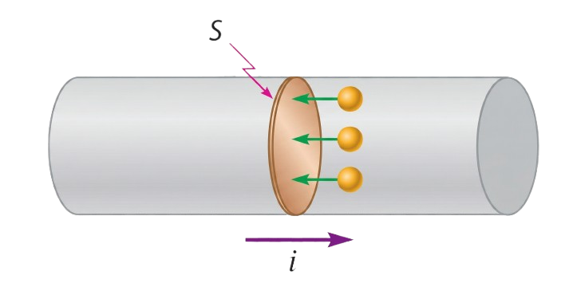
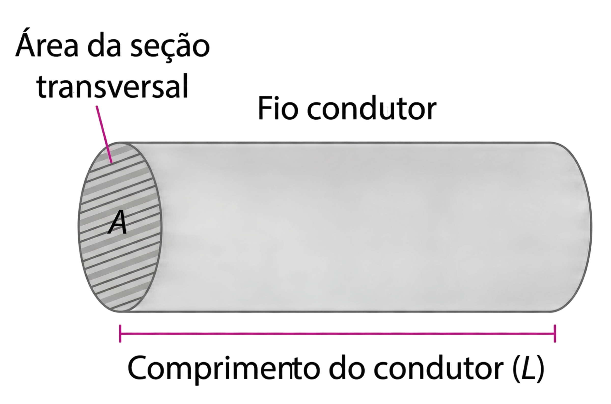
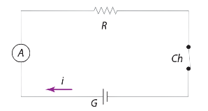
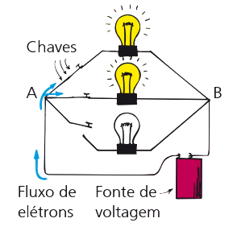
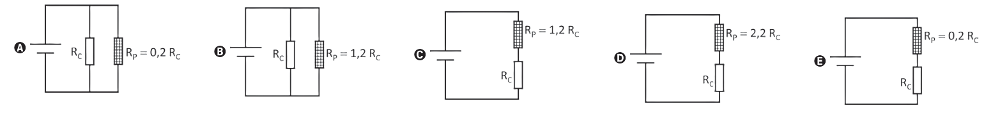

## Corrente Elétrica ($I$) {.smaller}

::::: columns
:::: {.column width="60%"}
A corrente elétrica é o movimento ordenado de cargas elétricas.

Considere um condutor metálico pelo qual passa uma corrente. Se destacarmos uma seção transversal $S$ desse condutor, passarão por ela, em um intervalo de tempo $\Delta t$, $n$ partículas elementares, correspondendo a uma carga $\Delta Q = n \cdot e$, sendo $e$ o módulo da carga do elétron, chamada **carga elementar** ($e = 1{,}6 \cdot 10^{-19}\ \text{C}$).

$$I = \frac{\Delta Q}{\Delta t} \quad \text{ou} \quad I = \frac{n \cdot e}{\Delta t}$$

onde $I$ é a corrente, $Q$ é a carga e $t$ é o tempo.

**Unidade no SI:** $\dfrac{\text{Coulomb (C)}}{\text{Segundo (s)}}$ ou Ampere (A).

**Sentido convencional:** do polo positivo (+) para o negativo (−).
::::

:::: {.column width="40%"}


::: callout-tip
### Analogia

Imagine um rio: a correnteza é o fluxo de água, assim como a corrente elétrica é o fluxo de elétrons.
:::
::::
:::::

------------------------------------------------------------------------

## O que é Tensão Elétrica (Voltagem)? {.smaller}

::::: columns
:::: {.column width="58%"}
A **Tensão Elétrica**, também conhecida como **voltagem** ou, tecnicamente, **diferença de potencial (ddp)**, é a fonte de energia que faz as cargas elétricas se moverem em um circuito.

**Fluxo de cargas:** cargas negativas (elétrons) são atraídas pelo polo positivo e repelidas pelo polo negativo, gerando uma corrente (sentido real).

$$U = \frac{E_p}{Q}$$

onde $U$ é a voltagem, $E_p$ é a energia potencial e $Q$ é a carga.

**Unidade no SI:** $\dfrac{\text{Joule (J)}}{\text{Coulomb (C)}}$ ou Volt (V).
::::

:::: {.column width="42%"}
::: callout-note
### A "pressão elétrica"

Ela representa quanta energia está disponível para "empurrar" cada unidade de carga (um Coulomb) através do fio. Se não houver diferença de energia entre dois pontos, as cargas não se movem e não há corrente.
:::

::: callout-tip
### Analogia

Podemos pensar como a diferença de altura que faz a água fluir em uma mangueira.
:::
::::
:::::

------------------------------------------------------------------------

## Resistores ($R$) {.smaller}

::::: columns
:::: {.column width="60%"}
Quando dizemos que um fio conduz corrente, não significa que os elétrons tenham o caminho livre. Ao se moverem, essas partículas chocam-se o tempo todo com a estrutura fixa dos átomos do condutor. Essas colisões funcionam como obstáculos, criando uma dificuldade natural para a passagem da corrente, conhecida como **resistência elétrica**. Por isso nenhum material é um condutor perfeito.

Mas onde vai parar a energia perdida nessas colisões? A cada choque, os elétrons transferem parte de sua energia para os átomos, fazendo-os vibrar com mais intensidade. Essa vibração aquece o material. Esse fenômeno de transformação de energia elétrica em calor devido à resistência é o **Efeito Joule**.
::::

:::: {.column width="40%"}
### Segunda lei de Ohm

$$R = \frac{\rho \cdot L}{A}$$



onde $R$ é a resistência elétrica, $\rho$ é a resistividade do material, $L$ é o comprimento do condutor e $A$ é a área da seção transversal do fio.
::::
:::::

------------------------------------------------------------------------

## A Primeira Lei de Ohm {.smaller}

A relação fundamental da eletrodinâmica estabelece que a tensão é proporcional à corrente para um condutor ôhmico.

$$U = R \cdot I$$

onde $U$ é a voltagem, $R$ é a resistência e $I$ é a corrente.

::::: columns
:::: {.column width="45%"}
Para um circuito onde a resistência é constante, a corrente e a voltagem são proporcionais entre si.

Isso significa que a corrente será duas vezes maior para uma voltagem duas vezes maior. Quanto maior a voltagem, maior a corrente.

Mas se a resistência do circuito for dobrada, a corrente terá metade do valor que teria antes. Quanto maior a resistência, menor a corrente.
::::

:::: {.column width="55%"}
```{python}
#| echo: false
import sys
sys.path.append("../../../src")   # onde está o dp_style.py

import plotly.graph_objects as go
from plotly.offline import get_plotlyjs
from IPython.display import HTML, display
import dp_style

R0 = 5.0                      # resistência inicial (Ω)
Is = [0, 10]                  # corrente de 0 a 10 A (2 pontos bastam)

fig = go.Figure()
# traço 0: a reta U = R · I
fig.add_trace(go.Scatter(
    x=Is, y=[R0 * i for i in Is], mode="lines",
    line=dict(color=dp_style.PALETTE["azul"], width=4),
    hovertemplate="I = %{x:.1f} A<br>U = %{y:.1f} V<extra></extra>",
))
# traço 1: ponto de destaque no fim da reta
fig.add_trace(go.Scatter(
    x=[10], y=[R0 * 10], mode="markers",
    marker=dict(color=dp_style.PALETTE["vermelho"], size=11),
    hovertemplate="I = %{x:.1f} A<br>U = %{y:.1f} V<extra></extra>",
))
fig.update_xaxes(range=[0, 10], title="Corrente (I) [A]", zeroline=True,
                 zerolinewidth=2)
fig.update_yaxes(range=[0, 200], title="Tensão (U) [V]", zeroline=True,
                 zerolinewidth=2)   # 200 = R máx. × I máx. = 20 × 10
fig = dp_style.plotly(fig, legend=False)
fig.update_layout(height=340, margin=dict(l=50, r=10, t=10, b=45))

# O Reveal só dimensiona o gráfico quando o slide aparece
resize_js = """
(function () {
  var g = document.getElementById('graf-ohm');
  function r() { if (g && window.Plotly) Plotly.Plots.resize(g); }
  var t = setInterval(function () {
    if (window.Reveal && Reveal.on) {
      clearInterval(t);
      Reveal.on('ready', r); Reveal.on('slidechanged', r); Reveal.on('resize', r);
      r();
    }
  }, 200);
  window.addEventListener('resize', r);
})();
"""

# A biblioteca plotly.js vai embutida (funciona offline), mas em uma saída
# SEPARADA do gráfico. Se saírem juntos, o Quarto tira o gráfico do slide.
display(HTML("<script>" + get_plotlyjs() + "</script>"))
display(HTML(fig.to_html(
    include_plotlyjs=False, full_html=False, div_id="graf-ohm",
    default_height="340px", default_width="100%",
    config={"responsive": True, "displayModeBar": False},
    post_script=resize_js,
)))
```

```{python}
#| echo: false
HTML("""
<div class="dp-controles">
  <div class="dp-eq">U = <span id="dp-ohm-eq">5 · I</span></div>
  <label>Resistência (R): <b id="dp-r-val">5</b> Ω
    <input id="dp-r-in" type="range" min="0" max="20" step="1" value="5">
  </label>
</div>
<style>
  .dp-controles { font-size: 0.8em; }
  .dp-controles .dp-eq { font-family: 'Space Grotesk', sans-serif; font-weight: 700;
    font-size: 1.1em; margin-bottom: 0.4em; color: rgb(var(--azul)); }
  .dp-controles label { display: block; margin: 0.4em 0; }
  .dp-controles input[type=range] { width: 100%; accent-color: rgb(var(--azul)); }
</style>
<script>
(function () {
  var ir = document.getElementById('dp-r-in');
  function upd() {
    var r = parseFloat(ir.value);
    var g = document.getElementById('graf-ohm');
    if (g && window.Plotly && g.data) {
      Plotly.restyle(g, {y: [[0, 10 * r]]}, [0]);
      Plotly.restyle(g, {y: [[10 * r]]}, [1]);
    }
    document.getElementById('dp-r-val').textContent = r.toFixed(0);
    document.getElementById('dp-ohm-eq').textContent = r.toFixed(0) + ' · I';
  }
  ir.addEventListener('input', upd);
})();
</script>
""")
```
::::
:::::

------------------------------------------------------------------------

## Circuito elétrico {.smaller}

::::: columns
:::: {.column width="50%"}
Qualquer caminho por onde os elétrons possam fluir é chamado de **circuito elétrico**.

Para um fluxo contínuo de elétrons, deve haver um circuito sem interrupções.

Uma **chave elétrica**, que pode ser ligada e desligada para estabelecer ou cortar o fornecimento de energia, é geralmente usada para implementar interrupções no circuito.
::::

:::: {.column width="50%"}
A maior parte dos circuitos possui mais de um dispositivo que recebe energia elétrica. Eles são conectados de uma entre duas maneiras: **em série** ou **em paralelo**.

- **Em série:** formam um único caminho para o fluxo de elétrons entre os terminais da bateria ou da tomada (que é uma extensão desses terminais).
- **Em paralelo:** formam ramos, cada um sendo um caminho separado para o fluxo eletrônico.

Cada tipo de conexão tem características próprias. Veremos rapidamente os dois.
::::
:::::

------------------------------------------------------------------------

## Circuito em Série {.smaller}

::::: columns
:::: {.column width="58%"}
Em um circuito em série, todos os componentes (como lâmpadas ou aparelhos) são organizados em uma fila única. Imagine uma estrada de mão única sem desvios: para chegar ao destino, você obrigatoriamente passa por todos os postos de controle no caminho.

### Como a corrente se comporta

**Fluxo contínuo:** a eletricidade não se desgasta nem "para" em um componente; ela flui através de todos simultaneamente. Assim que o interruptor é ligado, a corrente se estabelece em todo o percurso ao mesmo tempo.

**Intensidade igual:** como só existe um caminho, a corrente que passa pelo primeiro componente é exatamente a mesma que passa pelo último e pela fonte.

**Dependência mútua:** como todos estão na mesma linha, a continuidade do fluxo depende da integridade de cada peça.
::::

:::: {.column width="42%"}

::::
:::::

------------------------------------------------------------------------

## Circuito em Paralelo {.smaller}

::::: columns
:::: {.column width="58%"}
Em um circuito em paralelo, os componentes são conectados de modo que a corrente se divide em diferentes ramais. Imagine uma estrada que se abre em várias pistas laterais e depois se une novamente: você pode escolher qualquer pista para chegar ao mesmo destino.

**Divisão de fluxo:** a corrente total que sai da bateria se divide entre os caminhos disponíveis. Se um caminho oferece menos resistência (como uma lâmpada mais potente), ele recebe uma fatia maior da corrente.

**Tensão constante ($U$):** todos os componentes recebem a mesma voltagem da fonte. Se a bateria é de 12 V, cada lâmpada opera individualmente com 12 V.

**Independência operacional:** cada ramal funciona como um circuito próprio. O que acontece em uma "pista" não afeta obrigatoriamente a outra.
::::

:::: {.column width="42%"}

::::
:::::

------------------------------------------------------------------------

## Associação de resistores {.smaller}

::::: columns
:::: {.column width="50%"}
### Associação em Série

Os resistores são ligados de forma que a corrente ($I$) tenha apenas um caminho.

- **Corrente ($I$):** é a mesma em todos os resistores.
- **Tensão ($U$):** a tensão total é a soma das individuais: $U_{total} = U_1 + U_2 + \dots$
- **Resistência equivalente:**

$$R_{eq} = R_1 + R_2 + R_3 + \dots + R_n$$

::: callout-note
$R_{eq}$ será sempre maior que o maior resistor da série.
:::
::::

:::: {.column width="50%"}
### Associação em Paralelo

Os resistores são ligados aos mesmos nós, criando caminhos independentes.

- **Tensão ($U$):** é a mesma para todos os resistores.
- **Corrente ($I$):** a corrente total se divide entre os ramos.
- **Resistência equivalente:**

$$\frac{1}{R_{eq}} = \frac{1}{R_1} + \frac{1}{R_2} + \dots + \frac{1}{R_n}$$

::: callout-tip
### Casos especiais

Dois resistores: $R_{eq} = \dfrac{R_1 \cdot R_2}{R_1 + R_2}$

$n$ resistores iguais: $R_{eq} = \dfrac{R}{n}$
:::
::::
:::::

------------------------------------------------------------------------

## Simulações de circuitos

<iframe src="https://phet.colorado.edu/sims/html/circuit-construction-kit-dc/latest/circuit-construction-kit-dc_all.html?locale=pt_BR" width="100%" height="520" scrolling="no" allowfullscreen style="border: 1px solid #ccc; border-radius: 8px;">

</iframe>

------------------------------------------------------------------------

## Enem 2025 {.smaller}

::::: columns
:::: {.column width="50%"}
Em sua maioria, os equipamentos eletrônicos domésticos demandam baixa potência elétrica em corrente contínua. Para alimentá-los, uma fonte externa ou embutida transforma a corrente alternada em corrente contínua de baixa tensão. Entretanto, cada equipamento tem suas especificidades, e muitas vezes não é possível simplesmente trocar essas fontes sem levar em conta a tensão, a corrente ou a potência elétrica de saída.
::::

:::: {.column width="50%"}
Considere um equipamento de resistência elétrica $R_c$ que funciona corretamente apenas em um dado valor de tensão. Porém, a única fonte de alimentação disponível fornece uma tensão 20% superior à tensão recomendada. Para adaptar essa fonte ao aparelho, a associação de um resistor de proteção $R_p$, de potência adequada, se faz necessária.

**A configuração adequada do circuito e o valor do resistor de proteção, em relação ao valor da resistência do equipamento, são:**
::::
:::::

------------------------------------------------------------------------

## Enem 2025: alternativas

{width="100%"}

------------------------------------------------------------------------

## Resposta E {.smaller}

::::: columns
:::: {.column width="50%"}
O equipamento tem resistência $R_c$ e suporta uma ddp $U$. A fonte disponível fornece uma diferença de potencial 20% acima da suportada, ou seja, $1{,}2\,U$.

Seria necessária uma associação com um resistor de proteção $R_p$ que consumisse $0{,}2\,U$. Como cada elemento tem uma ddp diferente, a melhor associação é a **associação em série**.

Na associação em série, a corrente é a mesma em todos os elementos. Considerando $U = R \cdot i$, o resistor de proteção precisa ter uma resistência tal que sua ddp seja igual a $0{,}2\,U$.
::::

:::: {.column width="50%"}
::: passo
$0{,}2\,U = R_p \cdot i$
:::

::: passo
Com $U = R_c \cdot i$ (tensão de funcionamento do aparelho):

$0{,}2\,(R_c \cdot i) = R_p \cdot i$
:::

::: resposta
$$R_p = 0{,}2\,R_c$$
:::
::::
:::::

# Dúvidas?

```{=html}
<script>
// O Quarto marca o slide de título com "center", e o Reveal então o posiciona
// no meio da tela enquanto os demais ficam no topo (isso causava o "pulo").
(function () {
  var t = setInterval(function () {
    if (window.Reveal && Reveal.isReady && Reveal.isReady()) {
      clearInterval(t);
      var s = document.getElementById('title-slide');
      if (s) { s.classList.remove('center'); Reveal.layout(); }
    }
  }, 100);
})();
</script>
```
